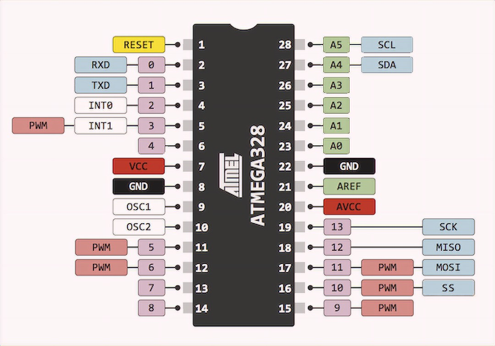
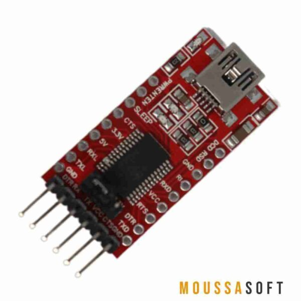
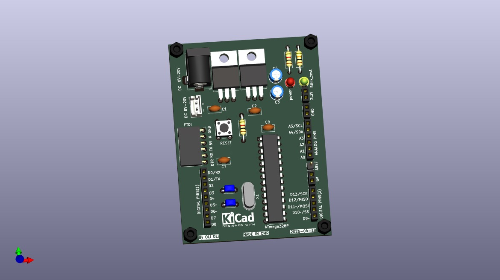
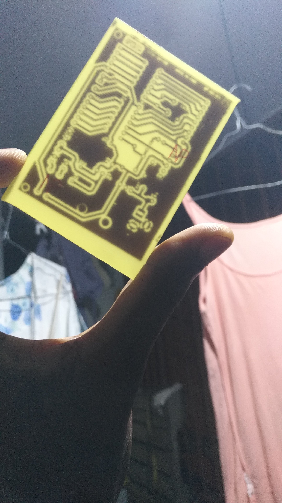
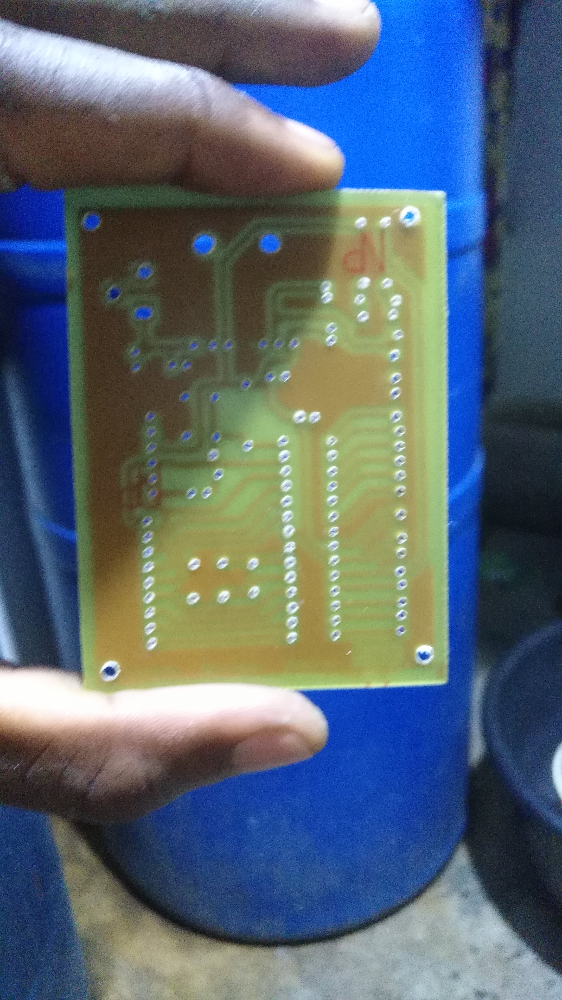
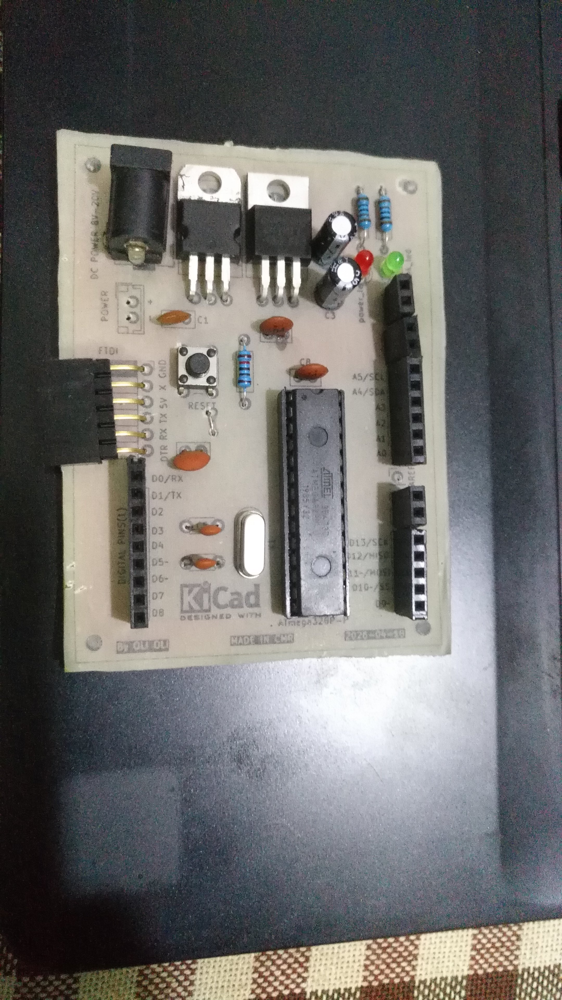
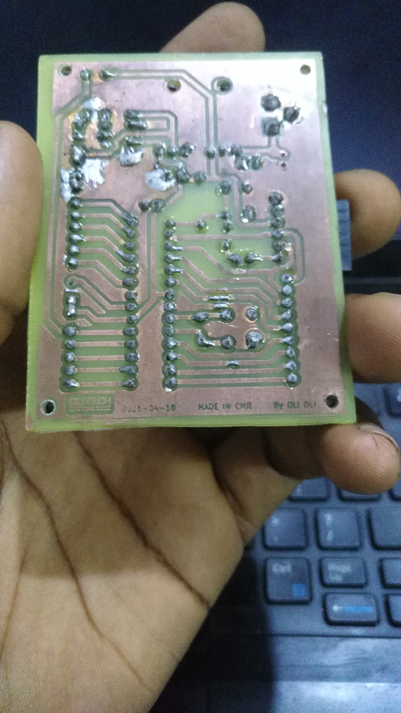
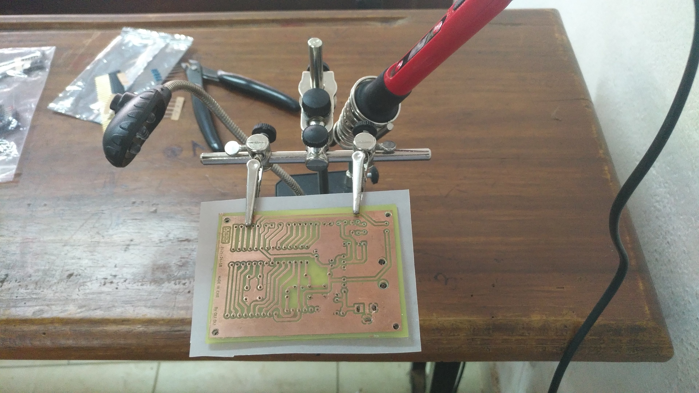
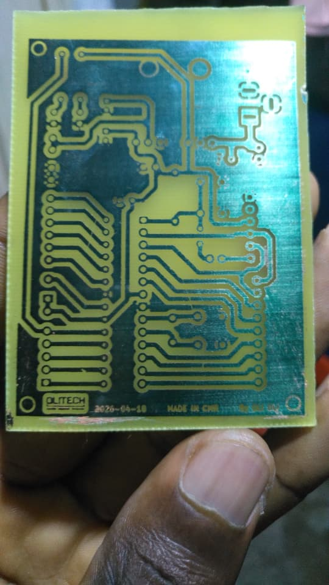
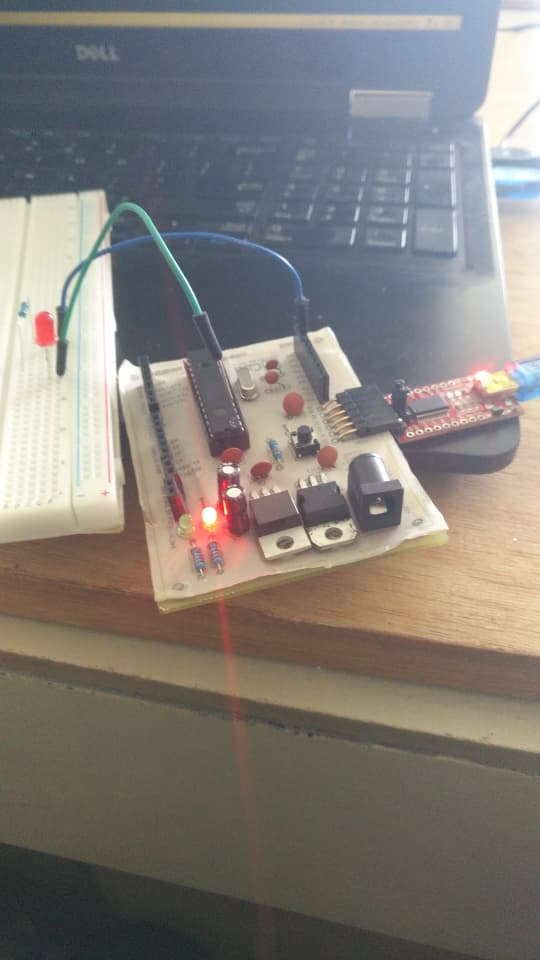

# ATmega328P Custom Arduino Board

**OLITECH · Carte de développement à microcontrôleur**

*A custom ATmega328P development board programmed through an FTDI USB-to-serial adapter.*

---

**Brand / Marque:** OLITECH  
**Designer / Concepteur:** OLI OLI DONALD  
**Country / Pays:** Cameroon / Cameroun  
**Design software / Logiciel de conception:** KiCad 9.0.7  
**Programming environment / Environnement de programmation:** Arduino IDE  
**Contact:** [oliolidonald186@gmail.com](mailto:oliolidonald186@gmail.com)

## Table of contents

- [Français](#-français)
  - [Présentation](#présentation)
  - [Architecture électronique](#architecture-électronique)
  - [Caractéristiques techniques](#caractéristiques-techniques)
  - [Programmation](#programmation)
  - [Galerie du projet](#galerie-du-projet)
  - [État de réalisation](#état-de-réalisation)
  - [Documents du projet](#documents-du-projet)
- [English](#-english)
  - [Overview](#overview)
  - [Electronic architecture](#electronic-architecture)
  - [Technical specifications](#technical-specifications)
  - [Programming](#programming)
  - [Project gallery](#project-gallery)
  - [Project status](#project-status)
  - [Project documentation](#project-documentation)
- [Contact](#contact)

---

## 🇫🇷 Français

### Présentation

**ATmega328P Custom Arduino Board** est un projet de conception et de réalisation d'une carte électronique de développement personnalisée autour du microcontrôleur **ATmega328P**.

La carte a été conçue sous **KiCad 9.0.7**, puis fabriquée, assemblée et testée. Elle constitue une plateforme matérielle permettant d'expérimenter avec le microcontrôleur et ses entrées/sorties, tout en utilisant un environnement de développement familier : l'IDE Arduino.

### Brochage du microcontrôleur ATmega328P-P

Le composant utilisé sur cette carte est référencé **ATmega328P-P** dans la liste des composants. L'illustration ci-dessous présente son brochage en boîtier DIP-28 et permet de repérer les principales broches : alimentation (VCC et AVCC), masses (GND), réinitialisation (RESET), oscillateur (XTAL1 et XTAL2), entrées analogiques (ADC) et entrées/sorties numériques (ports B, C et D).

  

Le repérage des broches est utile pour comprendre le schéma électronique, le raccordement des périphériques et l'affectation des entrées/sorties dans un programme Arduino. Il faut toutefois se référer au schéma de la carte pour connaître les connexions réellement utilisées dans cette réalisation.

### Architecture électronique

La carte intègre les principaux éléments nécessaires au fonctionnement du microcontrôleur :

- **Unité de traitement :** microcontrôleur ATmega328P.
- **Horloge :** quartz externe de 16 MHz associé à deux condensateurs de 22 pF.
- **Alimentation :** entrée continue indiquée sur le schéma entre 8 et 20 V DC.
- **Régulation :** régulateur L7805 pour le 5 V et LM1117T pour le 3,3 V.
- **Programmation :** connecteur destiné à un adaptateur FTDI USB-série.
- **Signalisation :** LED rouge et LED verte intégrées.
- **Connectique :** accès aux broches d'entrées/sorties numériques et analogiques.

### Caractéristiques techniques

| Paramètre | Description |
|---|---|
| Microcontrôleur | ATmega328P |
| Référence indiquée dans la nomenclature | ATmega328P-P |
| Logiciel de conception | KiCad 9.0.7 |
| Environnement de programmation | Arduino IDE |
| Interface de téléversement | Adaptateur FTDI USB-série |
| Communication de programmation | UART |
| Horloge externe | Quartz 16 MHz |
| Tension d'entrée indiquée sur le schéma | 8–20 V DC |
| Tension régulée | 5 V et 3,3 V |
| Régulateurs | L7805 et LM1117T |
| Indicateurs | LED rouge et LED verte |
| Connectique | Entrées/sorties numériques et analogiques |

### Programmation

Le microcontrôleur est programmé à l'aide de l'**IDE Arduino**. Le téléversement du programme s'effectue au moyen d'un **programmateur/adaptateur FTDI USB-série**, connecté à la carte via une liaison UART.

L'adaptateur FTDI assure l'interface entre le port USB de l'ordinateur et la communication série UART utilisée par l'ATmega328P. Il permet notamment de transmettre les données de programmation depuis l'IDE Arduino vers le microcontrôleur. La liaison nécessite un raccordement cohérent des signaux de communication (TX et RX croisés), ainsi qu'une masse commune (GND). Selon le modèle utilisé et le montage de la carte, d'autres broches peuvent être présentes, notamment l'alimentation et le contrôle de réinitialisation.

Le brochage exact du connecteur FTDI de cette réalisation sera précisé après confirmation du modèle de programmateur et de l'affectation des broches utilisées.

Le programmateur FTDI utilisé est présenté ci-dessous. Il s'agit de l'adaptateur USB-série qui assure la liaison entre l'ordinateur et l'interface UART de la carte.

  

Cet adaptateur convertit les données échangées par USB en signaux série UART compatibles avec la communication du microcontrôleur. Pour la liaison série, les lignes TX et RX doivent être raccordées de manière croisée et les deux équipements doivent partager une masse GND. Le brochage exact de l'adaptateur et son raccordement au connecteur de la carte seront détaillés à partir des inscriptions visibles sur le module et du schéma de la carte.

Le tutoriel [Passion Électronique – Programmer un ATmega328P](https://passionelectronique.fr/programmer-atmega328p/) a servi de ressource d'apprentissage pour comprendre cette méthode de programmation.

> La présence et la configuration d'un bootloader ne sont pas documentées dans ce projet.

### Galerie du projet

**Vue 3D de la carte conçue sous KiCad 9.0.7 :**

  

Les photographies suivantes documentent différentes vues de la carte réalisée et de son environnement de développement. Les autres photographies du projet sont disponibles dans le dossier [`images/`](images/), tandis que les documents PDF techniques sont regroupés dans [`documents/`](documents/).

| Vue | Aperçu |
|---|---|
| Vue 1 |  |
| Vue 2 |  |
| Vue 3 |  |
| Vue 4 |  |
| Vue 5 |  |
| Vue 6 |  |
| Vue 7 |  |

### État de réalisation

| Élément | État |
|---|---|
| Conception électronique | Réalisée |
| Conception du PCB | Réalisée |
| Fabrication de la carte | Réalisée |
| Assemblage des composants | Réalisé |
| Essais de la carte | Réalisés |
| Programmation avec Arduino IDE | Réalisée |
| Téléversement via adaptateur FTDI | Réalisé |

> **Note :** les mesures détaillées et les résultats chiffrés des essais ne sont pas présentés dans cette version de la documentation.

### Documents du projet

Les documents techniques sont regroupés dans le répertoire `documents/` :

| Document | Description |
|---|---|
| [SCHEMATIC ATMEGA328P.pdf](documents/SCHEMATIC%20ATMEGA328P.pdf) | Schéma électronique de la carte |
| [COTE COMPOSANT ATMEGA 328P.pdf](documents/COTE%20COMPOSANT%20ATMEGA%20328P.pdf) | Implantation des composants |
| [TYPON ATMEGA328P.pdf](documents/TYPON%20ATMEGA328P.pdf) | Typon du circuit imprimé |
| [liste_composants.pdf](documents/liste_composants.pdf) | Liste des composants (BOM) |

---

## 🇬🇧 English

### Overview

**ATmega328P Custom Arduino Board** is a project involving the design and implementation of a custom development board based on the **ATmega328P** microcontroller.

The board was designed using **KiCad 9.0.7**, then manufactured, assembled and tested. It provides a hardware platform for experimenting with the microcontroller and its I/O pins while using a familiar development environment: the Arduino IDE.

### ATmega328P-P microcontroller pinout

The component listed in the bill of materials is **ATmega328P-P**. The illustration below shows its DIP-28 pinout and helps identify the main pins: power supply (VCC and AVCC), ground (GND), reset (RESET), oscillator (XTAL1 and XTAL2), analog inputs (ADC), and digital input/output pins (ports B, C and D).

  

Understanding the pinout is useful when reading the electronic schematic, wiring peripherals, and assigning inputs and outputs in an Arduino program. The board schematic should still be used to identify the connections actually implemented in this design.

### Electronic architecture

The board integrates the main elements required for the microcontroller to operate:

- **Processing unit:** ATmega328P microcontroller.
- **Clock:** 16 MHz external crystal with two 22 pF capacitors.
- **Power input:** DC input indicated on the schematic as 8–20 V.
- **Voltage regulation:** L7805 regulator for 5 V and LM1117T regulator for 3.3 V.
- **Programming:** connector for an FTDI USB-to-serial adapter.
- **Status indication:** integrated red and green LEDs.
- **Connectivity:** access to digital and analog input/output pins.

### Technical specifications

| Parameter | Description |
|---|---|
| Microcontroller | ATmega328P |
| Part number specified in the BOM | ATmega328P-P |
| Design software | KiCad 9.0.7 |
| Programming environment | Arduino IDE |
| Upload interface | FTDI USB-to-serial adapter |
| Programming communication | UART |
| External clock | 16 MHz crystal |
| Input voltage indicated on schematic | 8–20 V DC |
| Regulated voltages | 5 V and 3.3 V |
| Voltage regulators | L7805 and LM1117T |
| Status indicators | Red and green LEDs |
| Connectivity | Digital and analog I/O pins |

### Programming

The microcontroller is programmed using the **Arduino IDE**. Firmware is uploaded through an **FTDI USB-to-serial programmer/adapter**, connected to the board using a UART serial interface.

The FTDI adapter provides an interface between the computer's USB port and the UART serial communication used by the ATmega328P. It transfers the firmware data from the Arduino IDE to the microcontroller. The communication signals must be connected correctly (TX and RX crossed), and the adapter and board must share a common ground (GND). Depending on the adapter model and board design, additional pins may be available for power and reset control.

The exact pinout of this project's FTDI connector will be documented once the programmer model and the connector's pin assignments have been confirmed.

The FTDI programmer used in this project is shown below. It is the USB-to-serial adapter that provides the connection between the computer and the board's UART interface.

  

The adapter converts USB data from the computer into UART serial signals used by the microcontroller. For serial communication, TX and RX must be connected crosswise, and both devices must share a common GND. The exact adapter pinout and its connection to the board will be documented using the labels visible on the module and the board schematic.

The [Passion Électronique – Programming an ATmega328P](https://passionelectronique.fr/programmer-atmega328p/) tutorial was used as a learning resource to understand this programming method.

> The presence and configuration of a bootloader are not documented in this project.

### Project gallery

**3D view of the board designed in KiCad 9.0.7:**

  

The following photographs document different views of the completed board and its development environment. All other project photographs are available in the [`images/`](images/) folder, while the technical PDF documents are stored in [`documents/`](documents/).

| View | Preview |
|---|---|
| View 1 |  |
| View 2 |  |
| View 3 |  |
| View 4 |  |
| View 5 |  |
| View 6 |  |
| View 7 |  |

### Project status

| Item | Status |
|---|---|
| Electronic design | Completed |
| PCB design | Completed |
| Board manufacturing | Completed |
| Component assembly | Completed |
| Board testing | Completed |
| Arduino IDE programming | Completed |
| Firmware upload via FTDI adapter | Completed |

> **Note:** detailed measurements and numerical test results are not included in this version of the documentation.

### Project documentation

The technical documents are stored in the `documents/` directory:

| Document | Description |
|---|---|
| [SCHEMATIC ATMEGA328P.pdf](documents/SCHEMATIC%20ATMEGA328P.pdf) | Board electronic schematic |
| [COTE COMPOSANT ATMEGA 328P.pdf](documents/COTE%20COMPOSANT%20ATMEGA%20328P.pdf) | Component placement |
| [TYPON ATMEGA328P.pdf](documents/TYPON%20ATMEGA328P.pdf) | PCB copper artwork |
| [liste_composants.pdf](documents/liste_composants.pdf) | Bill of materials (BOM) |

---

## Contact

**OLI OLI DONALD · OLITECH**  
Cameroon  
Email: [oliolidonald186@gmail.com](mailto:oliolidonald186@gmail.com)

*OLITECH — Electronic design and practical engineering.*
